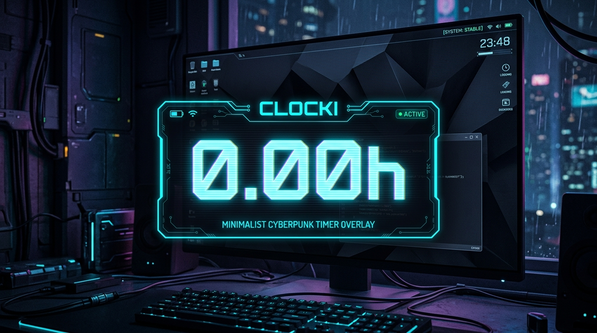
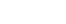

# Clocki ⏱️

> A minimalist, frameless desktop floating timer overlay for tracking daily focus hours.



<p align="center">
  
</p>


[](https://snapcraft.io/clocki)


[](https://snapcraft.io/clocki)


---

## Features

- **Tiny overlay**: Compact `66 × 24px` floating HUD.
- **Always on top**: Stays visible without taking over your workspace.
- **Instant controls**:
  - **Left click**: Pause / Resume.
  - **Double click**: Reset to `0.00h`.
  - **Right click**: Pause / Reset / Hide / Quit menu.
  - **Drag**: Reposition; Clocki remembers where you left it.
- **Global hotkeys**:
  - `Ctrl+Alt+T`: Pause / Resume timer.
  - `Ctrl+Alt+C`: Switch display mode (Timer / Clock).
  - `Ctrl+Alt+R`: Reset active timer session.
  - `Ctrl+Alt+H`: Show / Hide overlay.
- **Persistence**: Session history and window position survive restarts.
- **Daily reset**: Focus time automatically starts fresh each day.
- **Offline UI**: No remote font or web dependency.

---

## Quick Start

### Prerequisites

- Node.js 18+
- npm

```bash
npm install
npm run build
./clocki.sh
```

Reset from the terminal:

```bash
npm run reset
```

---

## Build a Snap

On Linux:

```bash
npm ci
npm run snap
```

The generated `.snap` is written to `release/`.

Install it locally for testing:

```bash
sudo snap install --dangerous release/clocki_*.snap
```

## Publish to the Snap Store

1. Create/sign into your Snapcraft developer account.
2. Request the public snap name `clocki` at `https://dashboard.snapcraft.io/register-snap/`. New names may require manual review.
3. Once the name is approved, authenticate and upload:

```bash
sudo snap install snapcraft --classic
snapcraft login
snapcraft upload --release=stable release/clocki_*.snap
```

The Snap uses strict confinement and supports native Wayland through Electron's global-shortcut portal.

---

## License

MIT © Masih Moafi

<!-- more-projects:start -->
## More projects

- [Elpis](https://github.com/MasihMoafi/Elpis): a coding agent for the terminal and desktop, with explicit context control
- [Rustidian](https://github.com/MasihMoafi/rustidian): a native Markdown notebook for Linux that opens Obsidian-format vaults
- [rag-mcp](https://github.com/MasihMoafi/rag-mcp): local hybrid search over your documents, as a CLI and MCP server
- [Skills](https://github.com/MasihMoafi/skills): SKILL.md workflows for coding agents
- [WhisperType](https://github.com/MasihMoafi/WhisperType): local voice input for developers
- [Read Aloud](https://github.com/MasihMoafi/read-aloud): select text, press Super+R, hear it in a local voice
- [Love Spot](https://github.com/MasihMoafi/love-spot): a shared drawing board where characters talk, draw and compete with you
- [SVG Studio](https://svg.masihmoafi.com): high-quality image vectorization
- [Pin](https://github.com/MasihMoafi/pin): an always-on-top priority note, saved as plain Markdown

All of them: [masihmoafi.com](https://masihmoafi.com/projects)
<!-- more-projects:end -->
